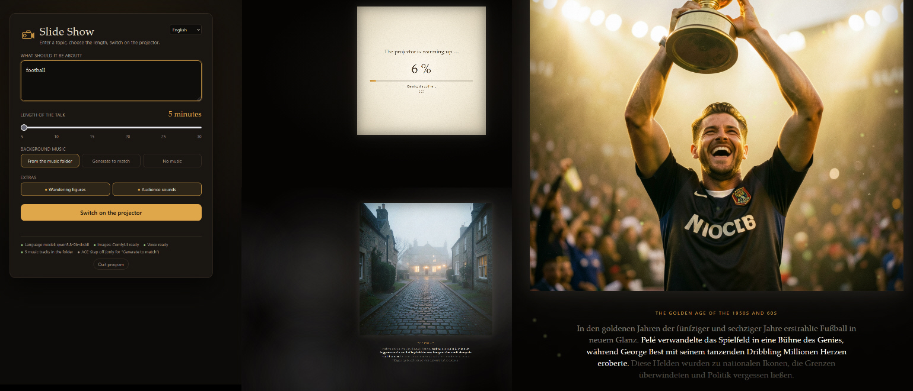

# Slideshow Presentation — Browser-based Slide Presentation (LM Studio Plugin)



## What it does

Enter your topic in the HTML window—whether it’s a narrative, an educational subject, a historical event like World War II, or a love story.
Specify the desired duration for the slideshow, and choose whether to include visual effects and music.
You can even have music generated specifically for your presentation—for example, Western-style music for a cowboy-themed talk.
Note that this requires VRAM; I recommend at least 12 GB, though it depends on the specific language model used.
The quality of the stories improves with the capability of the language model.
For music generation, the plugin downloads the ACE1.5 model.
For visuals, it uses Flux2 (at least the 4-step distilled version). It also downloads a language model.
The slideshow begins after a brief warm-up phase (typically taking between 2 and 5 minutes, depending on your computer).
Once it starts, you’ll see slide transitions, hear ambient sounds like an audience coughing, and watch as sprites appear to match the scene.

Available in multiple languages.
still in development

All graphics, music, and sound are AI-generated.

## How to use

- Open the page at http://127.0.0.1:8430 (bookmark it!) — or, within the LM Studio chat, simply say:
"Open the slideshow" (using the `diashow_oeffnen` tool).
- Enter your topic (feel free to add specific preferences, such as "for children" or "in a comic-book style"), select the duration, and **turn on the projector**.
- You can also start the presentation by pressing Ctrl+Enter while in the topic input field. ## Installation / After Changes

```powershell
cd <project-folder>
npm install
npm run build
lms dev --install
```

Then, in LM Studio: go to the right-hand sidebar → **"Program"** → **"Plugins"** → and enable `eliot/diashow-vortrag`.
LM Studio only initializes plugins when there is activity in the chat; once triggered, the slideshow server continues to run independently.

## Files

```
diashow/
├── manifest.json, package.json, tsconfig.json
├── src/                    LM Studio plugin (TypeScript)
│   ├── index.ts            Launches the slideshow server upon loading
│   ├── server.ts           Starts the server / opens the browser
│   └── toolsProvider.ts    `diashow_oeffnen` (open slideshow) tool
├── vortrag/                The actual slideshow presentation (Python, standard library only)
│   ├── server.py           Web server + processing pipeline (outline, text, images, voice, music)
│   ├── web/index.html      Landing page and projector view
│   ├── tts_dienst.py       Qwen3 TTS voice service (port 8431, qwen-tts-venv)
│   ├── erzaehler.py, tts_schnell.py   Voice handling + acceleration (from the roleplay system)
│   └── stimmen/            Reference recordings for the five speakers
├── musik/                  Background music (included in installation)
└── sounds/                 Venue/ambient sounds—`<type>_<number>.flac` (included in installation)
```

Generated images and audio are stored in: `%USERPROFILE%\LMStudioLocalPlugins\diashow-daten\vortraege\` (the 5 most recent presentations are kept;
older ones are deleted upon the next startup). Logs: `diashow-daten\server.log`, `diashow-daten\stimmdienst.log`.

## Ports

| Port | Service |
|---|---|
| 8430 | Slideshow page |
| 8431 | Slideshow Qwen3-TTS voice service |
| 8188 | ComfyUI |
| 1234 | LM Studio |
| 8001 | ACE-Step (optional) |
